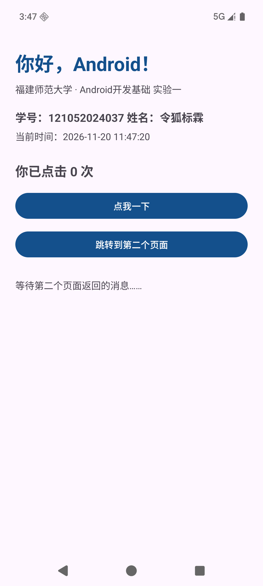
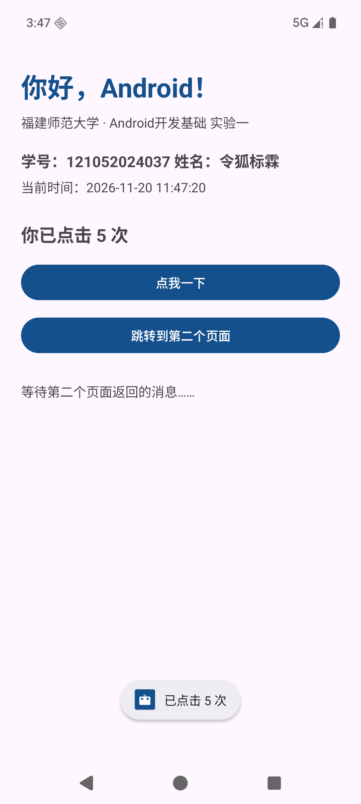
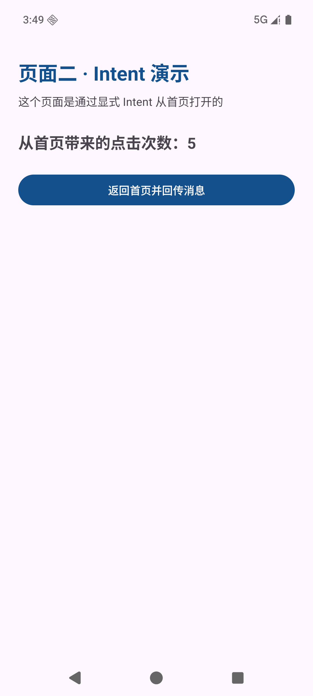
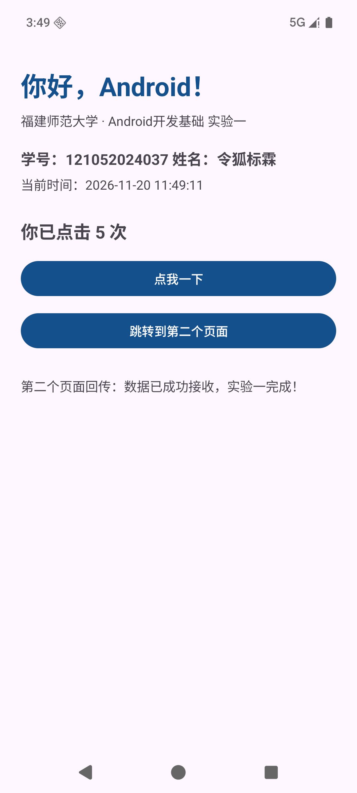

# AndroidLab1 · Android开发基础 实验一

福建师范大学《Android开发基础》实验一：创建一个 Android 工程，并把工程同步到 GitHub。

| 项目 | 内容 |
| --- | --- |
| 学号 | 121052024037 |
| 姓名 | 令狐标霖 |
| 语言 | Java |
| 编译版本 | compileSdk 37 / minSdk 26 / targetSdk 37 |
| 构建工具 | Gradle 9.9.1 + AGP 9.4.1 |

## 功能

1. 启动页显示「你好，Android！」、学号姓名、进入页面的当前时间。
2. 「点我一下」按钮：点击计数 + Toast 提示。
3. 「跳转到第二个页面」按钮：显式 Intent 跳转，并用 `putExtra` 携带点击次数。
4. 第二个页面通过 `setResult` 回传消息，首页用 `ActivityResultLauncher` 接收并显示。

## 目录结构

```
AndroidLab1
├── app
│   ├── build.gradle                 # 模块级构建脚本（compileSdk、ViewBinding、依赖）
│   └── src/main
│       ├── AndroidManifest.xml      # 四大组件注册
│       ├── java/com/fjnu/lhbl/lab1
│       │   ├── MainActivity.java    # 首页
│       │   └── SecondActivity.java  # 第二个页面
│       └── res
│           ├── layout/              # 两个布局文件
│           ├── values/              # colors / strings / themes
│           ├── drawable/            # 图标前景
│           └── mipmap-anydpi-v26/   # 自适应图标
├── gradle/libs.versions.toml        # 版本目录，集中管理依赖版本
├── build.gradle                     # 顶层构建脚本
├── settings.gradle                  # 仓库声明 + 包含的模块
├── gradle.properties                # 全局构建参数
└── .github/workflows/android.yml    # GitHub Actions 自动构建 APK
```

## 如何运行

1. Android Studio → File → Open → 选择本目录。
2. 等待右下角 Gradle Sync 完成（首次会下载依赖）。
3. 连接手机（开启 USB 调试）或启动模拟器，点击绿色三角 Run。

命令行构建：

```bash
./gradlew assembleDebug
```

产物路径：`app/build/outputs/apk/debug/app-debug.apk`

## 运行截图

<p align="center">




</p>

从左到右：首页初始态 → 点击五次后的计数与 Toast → 第二个页面显示传入的次数 → 回传消息在首页展示。
