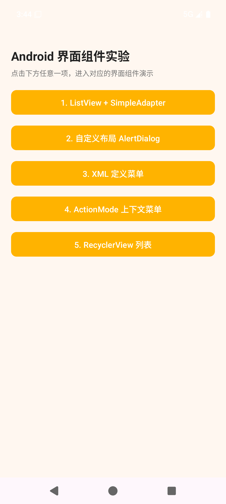
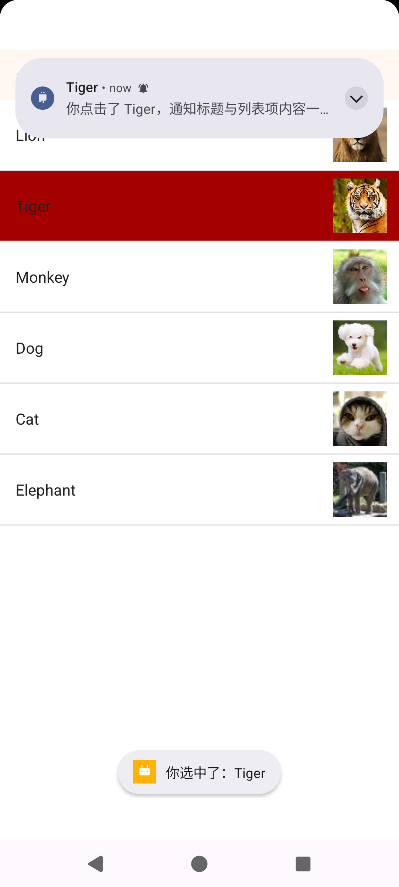
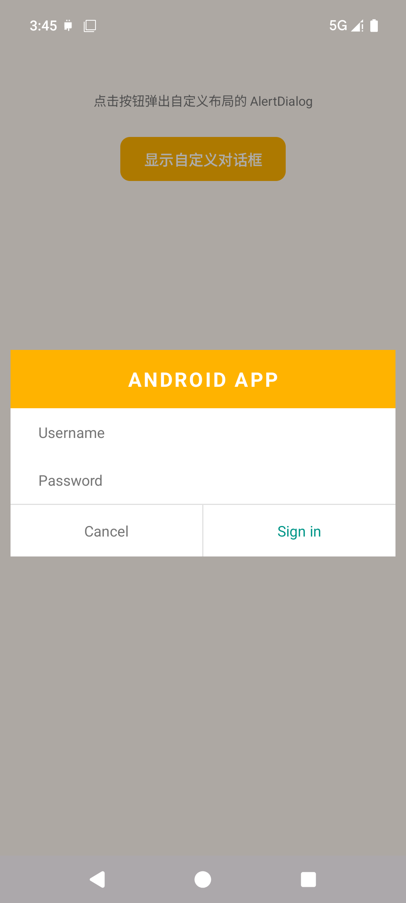
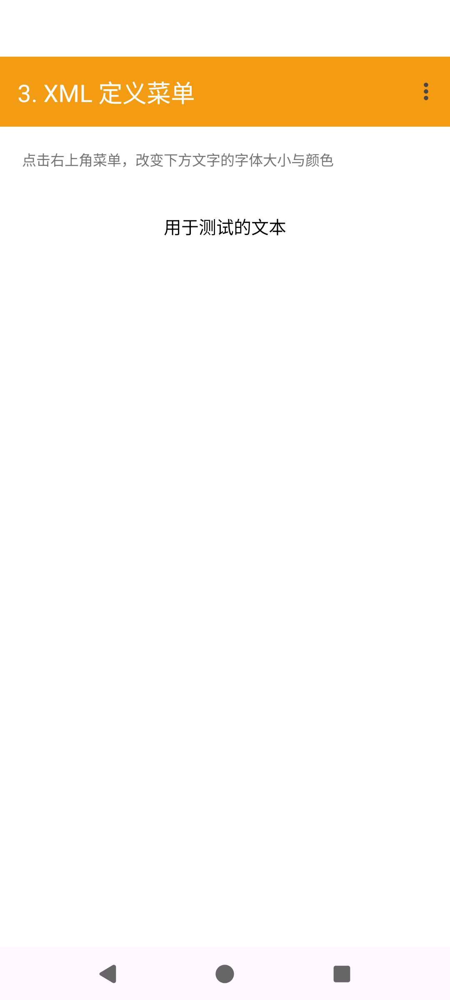
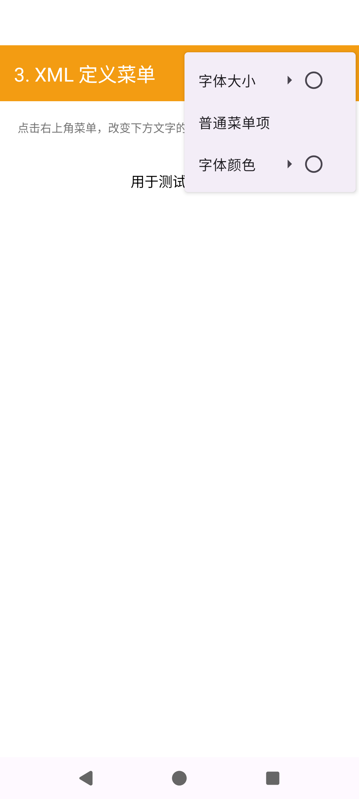
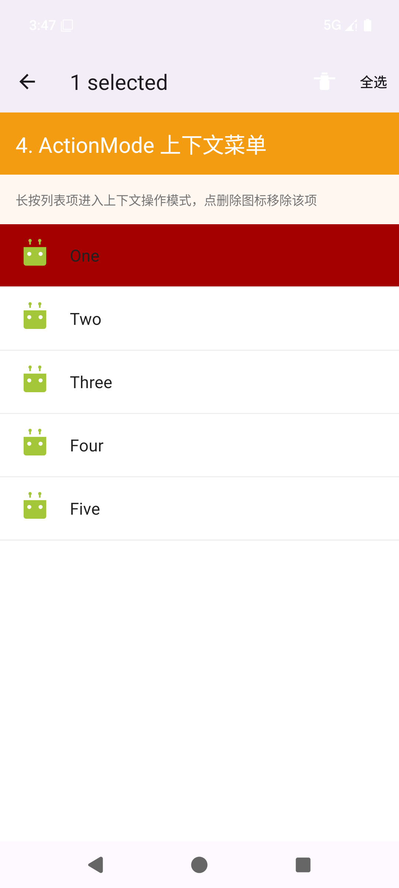
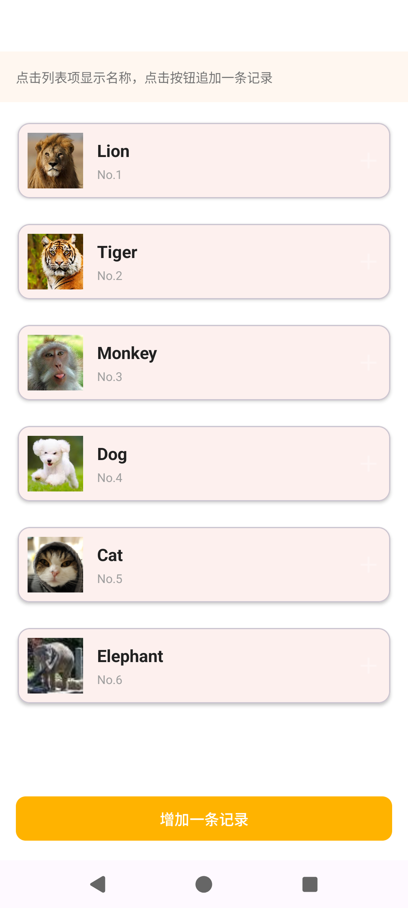

# 实验3 · Android 界面组件

福建师范大学《移动应用开发》实验三的完整工程，包含 ListView、自定义 AlertDialog、XML 菜单、ActionMode 与 RecyclerView 五个界面组件的实现，可直接导入 Android Studio 运行。

## 功能一览

| 模块 | 文件 | 说明 |
|---|---|---|
| 图文列表 | `ListViewDemoActivity` | `SimpleAdapter` 实现名称 + 图片列表，点击弹 Toast、发送通知、选中行变深红 |
| 自定义对话框 | `CustomDialogActivity` | `AlertDialog.Builder.setView()` 加载 `dialog_sign_in.xml`，两栏按钮与输入校验 |
| XML 菜单 | `MenuDemoActivity` | 字号子菜单（10/16/20sp）与颜色子菜单（红/黑），普通项弹 Toast |
| 上下文菜单 | `ActionModeListActivity` | 长按进入 `ActionMode`，标题 `1 selected`，删除图标移除该行 |
| 卡片列表 | `RecyclerDemoActivity` + `AnimalAdapter` | `RecyclerView` + `ViewHolder`，点击显示名称，追加记录后局部刷新不错位 |

## 运行环境

- Android Studio（AGP 9.5.1 / Gradle 9.9.1）
- JDK 17
- compileSdk 37，minSdk 24，targetSdk 37

## 构建

```bash
# Windows
gradlew :app:assembleDebug

# macOS / Linux
./gradlew :app:assembleDebug
```

产物位于 `app/build/outputs/apk/debug/app-debug.apk`。

依赖仓库在 `settings.gradle.kts` 中已配置阿里云镜像，官方 `google()` 作为回落；若你所在网络可以直连 Google Maven，删除镜像两行即可。

## 目录结构

```
app/src/main/java/com/fjnu/lab3/
├── MainActivity.java
├── ListViewDemoActivity.java
├── CustomDialogActivity.java
├── MenuDemoActivity.java
├── ActionModeListActivity.java
├── RecyclerDemoActivity.java
├── AnimalAdapter.java
└── Animal.java
app/src/main/res/
├── layout/     activity_main, activity_listview, item_animal, activity_dialog,
│               dialog_sign_in, activity_menu, activity_action_mode,
│               item_action_mode, activity_recycler, item_recycler
├── menu/       menu_font.xml, menu_action_mode.xml
└── drawable/   6 张动物图片 + 矢量图标 + 选择器
```

## 说明

- 通知需要 Android 13 及以上的 `POST_NOTIFICATIONS` 权限，入口页会在启动时申请；拒绝授权时页面仍可正常使用。
- 图片资源来自实验提供的素材，仅用于课程实验。

## 运行截图

<p align="center">




</p>

上排：入口页、图文列表、自定义登录对话框、XML 菜单页。

<p align="center">



</p>

下排：菜单子项展开、`ActionMode` 选中态、`RecyclerView` 卡片列表。


